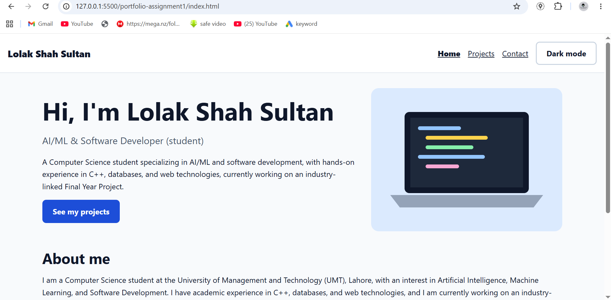

# Lolak Shah Sultan - Developer Portfolio

A responsive 3-page portfolio built with HTML, CSS and JavaScript only (CS-554 Assignment 1, Version A).

**Live site:** https://lolakshah.github.io/portfolio/

## Features
- Home, Projects and Contact pages with semantic HTML
- Project cards rendered with JavaScript, with search and technology filter
- Dark mode (follows the computer setting and has a toggle button that is remembered)
- Contact form with JavaScript validation and error messages
- Responsive layout using Flexbox and Grid

## Run locally
Open the folder in VS Code and use Live Server on `index.html`.